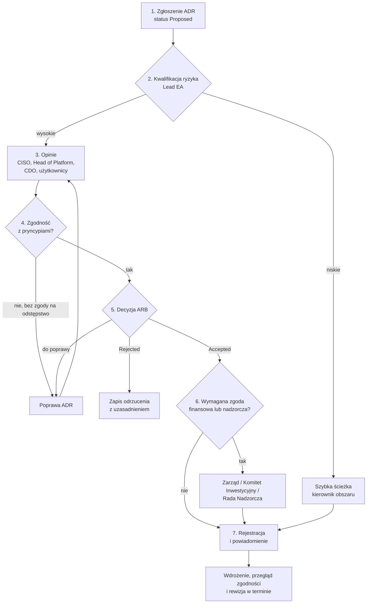

# Pryncypia i ład architektoniczny — PGP Fenestra S.A.

**Obszar frameworku:** Pryncypia i ład

Dokument opisuje „reguły gry” ustalane w Fazie Wstępnej cyklu ADM:

1. **Pryncypia architektoniczne:** nadrzędne zasady, które filtrują każdą decyzję w fazach A–D.
2. **Szablon ADR:** sposób zapisu decyzji architektonicznej, oparty na czterech elementach: Kontekst (problem i siły napędowe), Decyzja (konkretny wybór), Status (cykl życia) i Konsekwencje (bilans kompromisów).
3. **Proces uzyskania akceptacji:** kto, kiedy i jak zatwierdza decyzję, rozstrzyga spory i zgadza się na odstępstwa.

Dokument jest niezależny od technologii. Opisuje zasady i role, a nie konkretne produkty.

---

# Część 1. Pryncypia architektoniczne

## 1.1. Zasady stosowania

- Pryncypia obowiązują wszystkich: zarząd, działy biznesowe, IT, zakłady i dostawców wdrażających rozwiązania dla firmy.
- Każda decyzja zapisana w ADR wskazuje, których pryncypiów dotyczy. Zgodność sprawdza się w procesie akceptacji (Część 3).
- Pryncypia mogą być ze sobą w napięciu (np. szybkość i bezpieczeństwo). Wtedy rozstrzyga ARB, a kompromis zapisuje się w ADR. Pierwszeństwo mają zawsze **P5 (bezpieczeństwo i prawo)**, a następnie **P4 (ciągłość produkcji)**.
- Odstępstwo od pryncypium jest możliwe tylko przez formalną zgodę (Część 3, pkt 3.8).
- Pryncypia przegląda się raz w roku oraz przy dużej zmianie strategii lub struktury właścicielskiej firmy (Faza H).

## 1.2. Przegląd pryncypiów

| ID | Nazwa | Grupa |
|---|---|---|
| P1 | Korzyść dla całej firmy | Biznesowe |
| P2 | Wspólne standardy dla całej firmy | Biznesowe |
| P3 | Ścieżka decyzyjna dostosowana do ryzyka | Biznesowe |
| P4 | Ciągłość produkcji | Biznesowe |
| P5 | Bezpieczeństwo i zgodność z prawem od początku | Biznesowe |
| P6 | Przewidywalne koszty | Biznesowe |
| P7 | Człowiek odpowiada za decyzję | Biznesowe |
| P8 | Jedno źródło danych | Danych |
| P9 | Pełna historia produktu | Danych |
| P10 | Kontrola firmy nad know-how | Danych |
| P11 | Wspólne pojęcia i klasyfikacja danych | Danych |
| P12 | Gotowe rozwiązania przed własnymi | Aplikacji |
| P13 | Rozwiązania tworzone z użytkownikami | Aplikacji |
| P14 | Świadome zarządzanie długiem technologicznym | Technologiczne |
| P15 | Porządek w integracji systemów | Technologiczne |
| P16 | Niezależność od dostawcy | Technologiczne |

## 1.3. Pryncypia biznesowe

### P1. Korzyść dla całej firmy
**Stwierdzenie:** Decyzje i priorytety wybiera się według korzyści dla całej firmy, a nie dla jednego działu lub zakładu.

**Uzasadnienie:** Działy mają różne cele i rywalizują o te same ograniczone zasoby, w tym o niewielki budżet na innowacje. Decyzja korzystna dla jednego działu nie musi być najlepsza dla całej firmy.

**Implikacje:**
- Pomysły wszystkich działów ocenia się według wspólnych kryteriów. Wygrywa ten, który przynosi firmie największą korzyść.
- Dział nie zawsze dostanie to, czego potrzebuje, jeśli firma ma ważniejsze potrzeby.
- Rozwiązanie zbudowane dla jednego działu udostępnia się innym, jeśli rozwiązuje także ich problem.

### P2. Wspólne standardy dla całej firmy
**Stwierdzenie:** Cała firma pracuje według wspólnych standardów. Wyjątki są dopuszczalne tylko wtedy, gdy są uzasadnione i zatwierdzone.

**Uzasadnienie:** Zamówienie przechodzi przez kilka zakładów i biur. Jeśli każde z nich działa po swojemu, łatwo o opóźnienia i błędy. Standaryzacja ułatwia też ocenę firmy przez inwestorów i podnosi jej wartość rynkową.

**Implikacje:**
- Standardy ustala ARB razem z przedstawicielami zakładów.
- Odstępstwa wymagają uzasadnienia i zgody. O zgodzie decyduje ARB albo kierownik obszaru, zależnie od ryzyka.
- W nowych procesach standardy wprowadza się od razu, w istniejących przy okazji zmian.
- Firma ponosi koszt tworzenia i utrzymania standardów. Elastyczność procesów jest ograniczona.

### P3. Ścieżka decyzyjna dostosowana do ryzyka
**Stwierdzenie:** Sposób zatwierdzania decyzji zależy od jej ryzyka. Drobne decyzje przechodzą szybką ścieżkę, a ryzykowne pełną.

**Uzasadnienie:** Jeśli każda decyzja przechodzi tę samą długą ścieżkę, ludzie zaczynają ją omijać, a drobne usprawnienia czekają miesiącami albo wcale nie powstają.

**Implikacje:**
- ARB ustala, czym jest niskie, a czym wysokie ryzyko.
- Decyzje o niskim ryzyku podejmuje kierownik obszaru, a w razie wątpliwości pyta ARB.
- Każda decyzja jest krótko zapisana: kto, co i dlaczego.
- Każda ścieżka ma termin. Brak decyzji w terminie przekazuje się wyżej i nie oznacza ani zgody, ani odmowy.
- Firma woli drobną pomyłkę niż brak decyzji. Za decyzję podjętą zgodnie z zasadami nikt nie odpowiada osobiście.

### P4. Ciągłość produkcji
**Stwierdzenie:** Ciągłość produkcji ma pierwszeństwo przed szybkością zmian.

**Uzasadnienie:** Przestój zatrzymuje pracę ludzi i maszyn, a jego koszt zwykle przewyższa zysk z szybszego wdrożenia.

**Implikacje:**
- Zmiana musi być przetestowana, zanim trafi na produkcję. Musi istnieć plan pozwalający ją wycofać.
- Wpływ zmiany na produkcję ocenia ARB razem z przedstawicielem zakładu.
- Dla każdego rozwiązania ważnego dla produkcji wiadomo, kto przyjmuje zgłoszenie awarii.
- Rozwiązanie ważne dla produkcji jest stale nadzorowane i ma tryb awaryjny, który pozwala pracować dalej, gdy zawiedzie.
- Istnieje awaryjna ścieżka decyzyjna dla nagłych przypadków. Decyzje podjęte w tym trybie opisuje się po fakcie.
- Zmiany trwają dłużej i więcej kosztują.

### P5. Bezpieczeństwo i zgodność z prawem od początku
**Stwierdzenie:** Bezpieczeństwo i zgodność z prawem uwzględnia się od pierwszego etapu prac nad rozwiązaniem.

**Uzasadnienie:** Wyciek danych, atak albo złamanie przepisów mogą zatrzymać produkcję, narazić firmę na kary i obniżyć jej wartość.

**Implikacje:**
- Wymagania bezpieczeństwa i przepisów ustala się razem z innymi wymaganiami, a ich zakres określa CISO.
- Rozwiązanie, które ich nie spełnia, nie może zostać wdrożone, także w trybie awaryjnym.
- Dostawców ocenia się pod kątem bezpieczeństwa, zanim firma zawrze z nimi umowę.
- Tworzenie rozwiązań trwa dłużej i wymaga testów bezpieczeństwa.

### P6. Przewidywalne koszty
**Stwierdzenie:** Wybór rozwiązania opiera się na oszacowanym pełnym koszcie i zysku z jego używania.

**Uzasadnienie:** Koszty ponoszone przez firmę muszą być przewidywalne. Spółka preferuje wydatki, które można uznać za jej majątek.

**Implikacje:**
- Pełny koszt obejmuje wdrożenie, utrzymanie, pracę ludzi oraz koszt ewentualnej rezygnacji z rozwiązania.
- Koszty zależne od użycia mają ustalony limit i są stale pilnowane.
- Przy wyborze dostawcy liczą się też warunki umowy: przewidywalność ceny i możliwość rezygnacji.
- Przy podobnym koszcie i ryzyku wygrywa rozwiązanie, które staje się majątkiem firmy.
- Przygotowanie decyzji zajmuje więcej czasu, a część rozwiązań tanich na start odpada.

### P7. Człowiek odpowiada za decyzję
**Stwierdzenie:** Narzędzia automatyczne, w tym oparte na sztucznej inteligencji, wspierają ludzi, ale za decyzje wpływające na bezpieczeństwo, produkcję, finanse lub klientów odpowiada wskazany człowiek.

**Uzasadnienie:** Narzędzia automatyczne mogą się mylić w sposób trudny do przewidzenia, a coraz częściej działają samodzielnie w imieniu użytkownika. Błędna wycena, zalecenie naprawy albo tłumaczenie może kosztować firmę pieniądze, zdrowie ludzi lub reputację.

**Implikacje:**
- Dla każdego zautomatyzowanego procesu wskazuje się osobę odpowiedzialną za jego wyniki.
- Wyniki w obszarach wysokiego ryzyka zatwierdza człowiek, zanim zostaną użyte.
- Narzędzie działa tylko w granicach uprawnień, które nadała mu firma.
- Działania narzędzia są zapisywane tak, aby dało się odtworzyć, jak powstała decyzja.
- Część procesów będzie zautomatyzowana w mniejszym stopniu, niż pozwala technika.

## 1.4. Pryncypia danych

### P8. Jedno źródło danych
**Stwierdzenie:** Każda informacja ma jedno źródło i trafia do niego od razu, gdy powstaje.

**Uzasadnienie:** Dane trzymane w różnych miejscach szybko przestają się zgadzać, a decyzje opierają się na nieaktualnych informacjach.

**Implikacje:**
- Za dane odpowiada kierownik obszaru, którego dotyczą, a CDO ustala wspólne zasady.
- Dane wprowadza ten, kto je tworzy.
- Prywatne kopie, np. własne arkusze, nie są źródłem informacji.
- Narzędzie do wprowadzania danych musi być wygodne, inaczej ludzie będą szukać obejść.
- Firma ponosi koszt narzędzi i przeniesienia istniejących danych.

### P9. Pełna historia produktu
**Stwierdzenie:** Firma zna historię każdego wyrobu: od surowca, przez produkcję, po recykling.

**Uzasadnienie:** Od 2027 roku regulacje Unii Europejskiej zobowiązują firmę do dostarczania Cyfrowego Paszportu Produktu dla każdego wyrobu budowlanego.

**Implikacje:**
- Za kompletność historii wyrobu odpowiada wyznaczony właściciel danych produktu.
- Każdy zakład dopisuje dane ze swojego etapu do wspólnego źródła danych.
- Dział zakupów wymaga od dostawców w umowach przekazywania wymaganych danych.
- Firma ponosi koszt prowadzenia ewidencji. Wybór dostawców ogranicza się do tych, którzy potrafią dostarczyć wymagane dane.

### P10. Kontrola firmy nad know-how
**Stwierdzenie:** Wiedza firmy jest spisana i chroniona, a firma decyduje, kto ma do niej dostęp.

**Uzasadnienie:** Przewaga firmy opiera się na jej wiedzy, którą można stracić przez wyciek albo odejście pracownika.

**Implikacje:**
- Każdy obszar wiedzy ma właściciela, który decyduje, co jest zapisane i kto ma do tego dostęp.
- Zasady dostępu ustala właściciel wspólnie z CISO.
- Poufna wiedza nie może trafiać do niezatwierdzonych narzędzi. Firma zapewnia zatwierdzone narzędzia, prowadzi ich wykaz i zasady, co można do nich przekazywać.
- Pracownicy spisują swoją wiedzę na bieżąco, także wiedzę o obejściach i naprawach.
- Pracownicy mają mniej swobody i poświęcają czas na spisywanie wiedzy.

### P11. Wspólne pojęcia i klasyfikacja danych
**Stwierdzenie:** Każda ważna informacja ma wspólną definicję, określoną klasę poufności i znaną jakość.

**Uzasadnienie:** To samo pojęcie bywa rozumiane inaczej w różnych zakładach, działach i krajach, a dane bywają zdublowane lub nieczytelne. Na takich danych nie da się oprzeć wiarygodnych decyzji, ani ludzkich, ani automatycznych.

**Implikacje:**
- CDO prowadzi wspólny słownik pojęć biznesowych, a właściciele danych go uzupełniają.
- Każdy zbiór danych ma klasę poufności. Od niej zależy, gdzie i przez kogo dane mogą być przetwarzane (P10).
- Właściciel danych mierzy ich jakość. Dane o nieznanej lub niskiej jakości nie mogą być podstawą automatycznych decyzji (P7).
- Porządkowanie danych kosztuje czas i opóźnia część projektów.

## 1.5. Pryncypia aplikacji

### P12. Gotowe rozwiązania przed własnymi
**Stwierdzenie:** Preferowane są gotowe rozwiązania z rynku. Własne buduje się tylko wtedy, gdy dają firmie przewagę nad konkurencją, gdy gotowe są zbyt drogie albo zagrażają know-how.

**Uzasadnienie:** Dział IT nie jest w stanie sam zbudować i utrzymać każdego rozwiązania. Gotowe rozwiązania mogą jednak nie pasować do profilu firmy i nie wyróżnią jej na tle konkurencji.

**Implikacje:**
- Wybór między zakupem, budową a rozbudową istniejącego rozwiązania zapisuje się w ADR.
- Przy wyborze gotowego rozwiązania ocenia się pełny koszt w czasie (P6) i możliwość zmiany dostawcy (P16).
- Przed dużą zmianą własnego rozwiązania sprawdza się, czy nie lepiej zastąpić go gotowym.
- Firma staje się zależna od dostawców i czasem musi dostosować swoje procesy.

### P13. Rozwiązania tworzone z użytkownikami
**Stwierdzenie:** W tworzeniu rozwiązania biorą udział przedstawiciele grup, których ono dotyczy.

**Uzasadnienie:** Osoby budujące rozwiązanie często nie znają realiów pracy jego użytkowników, a niedopasowane rozwiązanie zachęca do szukania obejść.

**Implikacje:**
- Użytkownicy biorą udział w zbieraniu wymagań, ocenie projektu i odbiorze przed wdrożeniem.
- Każdy dział, którego dotyczy rozwiązanie, wskazuje swojego przedstawiciela.
- Rozwiązanie, które ma zastąpić nieoficjalne obejście, musi być dla użytkownika co najmniej tak wygodne jak to obejście.
- Odrzucenie uwag użytkowników wymaga zapisania przyczyny. Drobne zmiany nie wymagają udziału użytkowników.
- Użytkownicy poświęcają czas na tworzenie rozwiązania. Rozwiązanie powstaje dłużej.

## 1.6. Pryncypia technologiczne

### P14. Świadome zarządzanie długiem technologicznym
**Stwierdzenie:** Dług technologiczny zaciąga się tylko świadomie i z planem spłaty, a tego samego problemu nie rozwiązuje się dwa razy.

**Uzasadnienie:** Każde zdublowane rozwiązanie i każdy skrót trzeba utrzymywać, a niekontrolowany dług obciąża budżet i obniża wartość firmy.

**Implikacje:**
- Wpływ decyzji na dług technologiczny zapisuje się w ADR.
- Lead Enterprise Architect prowadzi ewidencję długu i nadzoruje plany jego spłaty.
- Dług spłaca się w ustalonym czasie i przy okazji zmian. Firma zapewnia na to zasoby.
- Firma godzi się na koszt zaciągania i spłaty długu.

### P15. Porządek w integracji systemów
**Stwierdzenie:** Systemy łączy się ze sobą według ustalonych standardów.

**Uzasadnienie:** Systemy połączone w nieuporządkowany sposób sprawiają problemy przy utrzymaniu, a poszczególne elementy trudniej jest wymienić.

**Implikacje:**
- ARB ustala dopuszczalne sposoby łączenia systemów.
- Każde połączenie jest opisane, żeby było wiadomo, co od czego zależy.
- Nieuporządkowane połączenia traktuje się jak dług technologiczny (P14).
- Nowe integracje powstają dłużej i są droższe.

### P16. Niezależność od dostawcy
**Stwierdzenie:** Rozwiązania projektuje się tak, aby można było zmienić dostawcę lub produkt bez przebudowy całości.

**Uzasadnienie:** Rynek rozwiązań, szczególnie w obszarze sztucznej inteligencji, zmienia się co kilka miesięcy. Uzależnienie od jednego dostawcy ogranicza wybór, podnosi koszty i grozi utratą kontroli nad danymi i wiedzą firmy.

**Implikacje:**
- Przy wyborze rozwiązania ocenia się koszt i czas ewentualnej zmiany dostawcy.
- Dane i wiedza firmy pozostają jej własnością i dają się przenieść do innego rozwiązania.
- Uzależnienie kluczowej funkcji od jednego dostawcy wymaga świadomej decyzji ARB zapisanej w ADR.
- Czasem trzeba zrezygnować z wygody i rabatów oferowanych przez jednego dostawcę.

---

# Część 2. Szablon ADR

Szablon opiera się na czterech elementach ADR: **Kontekst, Decyzja, Status i Konsekwencje**. Dodano tylko pola potrzebne do procesu akceptacji i wymagane przez pryncypia.

- **Szybka ścieżka (ryzyko niskie):** wystarczy metryka oraz po 1–2 zdania w sekcjach 1, 2 i 4 (kto, co, dlaczego).
- **Pełna ścieżka (ryzyko wysokie):** wypełnia się wszystkie pola.
- **Jeden ADR to jedna decyzja.** Zwykle 1–2 strony.

```markdown
# ADR-NNN: [Krótki tytuł decyzji]

| Pole | Wartość |
|---|---|
| Status | Proposed / Accepted / Rejected / Deprecated / Superseded |
| Data zgłoszenia | RRRR-MM-DD |
| Autor | [imię i nazwisko, rola] |
| Sponsor biznesowy | [imię i nazwisko, rola] |
| Poziom ryzyka i ścieżka | niskie – szybka / wysokie – pełna / awaryjna |
| Decydent | [kierownik obszaru / ARB / COO lub CCO w trybie awaryjnym] |
| Data i dowód zatwierdzenia | [RRRR-MM-DD, np. protokół ARB; „oczekuje”] |

## 1. Kontekst — problem i siły napędowe
- **Potrzeba biznesowa:** [co i dlaczego trzeba rozwiązać; skutki braku decyzji]
- **Ograniczenia:** [istniejące systemy, organizacja, budżet, terminy]
- **Regulacje i bezpieczeństwo:** [przepisy i wymagania, które mają znaczenie]
- **Powiązane pryncypia:** [np. P4, P7, P12]
- **Pytanie decyzyjne:** [na jakie konkretne pytanie odpowiada ten ADR]

## 2. Decyzja — konkretny wybór
**Postanowiono:** [1–3 zdania: co dokładnie robimy i gdzie to obowiązuje]

**Rozważane opcje** (co najmniej dwie, w tym „nic nie zmieniamy”):

| Opcja | Zalety | Wady / powód odrzucenia |
|---|---|---|
| A — [wybrana] | | |
| B — [alternatywa] | | |

**Kupić / zbudować / rozbudować istniejące (P12):** [wybór i uzasadnienie; usuń, jeśli nie dotyczy]

## 3. Status — cykl życia
- **Historia statusu:** [data – status – kto zdecydował – dowód]
- **Zastępuje / zastąpiona przez:** [ADR-NNN; usuń, jeśli nie dotyczy]
- **Kiedy zrewidować:** [data lub warunek, np. koniec umowy, zmiana przepisów]

## 4. Konsekwencje — bilans kompromisów

| Obszar | Zyskujemy | Tracimy / ryzyko |
|---|---|---|
| Koszt całkowity (TCO), limity kosztów (P6) | | |
| Czas i opóźnienia | | |
| Uzależnienie od dostawcy (P16) | | |
| Ciągłość produkcji: plan wycofania, kto przyjmuje awarie (P4) | | |
| Bezpieczeństwo i zgodność z prawem (P5) | | |
| Dane i know-how (P8–P11) | | |
| Dług technologiczny: zaciągany / spłacany, plan (P14) | | |

- **Odstępstwa od pryncypiów:** [które, do kiedy, plan powrotu do zgodności, dowód zgody; usuń, jeśli nie dotyczy]
- **Odpowiedź na obiekcje ARB** (co najmniej dwie persony): [persona – obiekcja – jak decyzja na nią odpowiada]
- **Działania wymagane:** [co, kto, do kiedy]
```

---

# Część 3. Proces uzyskania akceptacji

## 3.1. Kiedy potrzebny jest ADR

ADR sporządza się, gdy decyzja:
- zmienia sposób działania więcej niż jednego zespołu, działu lub zakładu,
- spełnia którekolwiek kryterium wysokiego ryzyka (pkt 3.3),
- jest odstępstwem od pryncypium lub standardu,
- dotyczy wyboru, zakupu, budowy albo wycofania rozwiązania.

Rutynowe zmiany mieszczące się w zatwierdzonych standardach nie wymagają ADR. Zgodnie z zasadą ograniczania zakresu (scoping) nie tworzy się zbędnej dokumentacji.

## 3.2. Role

| Rola | Zadanie w procesie |
|---|---|
| **Autor** | Przygotowuje ADR, proponuje poziom ryzyka, zbiera opinie i zapisuje wynik. |
| **Sponsor biznesowy** | Odpowiada za uzasadnienie biznesowe. Uczestniczy w ARB przy swojej sprawie. |
| **Kierownik obszaru** | Zatwierdza decyzje i odstępstwa niskiego ryzyka w swoim obszarze. |
| **Lead Enterprise Architect** | Przewodniczy ARB, prowadzi rejestr ADR i ewidencję długu technologicznego, potwierdza poziom ryzyka i sprawdza zgodność wdrożenia. |
| **ARB** | Lead EA, CISO, Head of Platform, CDO i Sponsor biznesowy danej sprawy. Zatwierdza decyzje wysokiego ryzyka, rozstrzyga spory i zgadza się na odstępstwa. |
| **Opiniujący obowiązkowi** | CISO przy sprawach bezpieczeństwa, prawa i know-how. Head of Platform i przedstawiciel zakładu przy sprawach produkcji i utrzymania. CDO przy sprawach danych. Przedstawiciel użytkowników przy rozwiązaniach dla konkretnych grup (P13). |
| **COO lub CCO** | Podejmuje decyzje w ścieżce awaryjnej. |
| **Organy finansowe i nadzorcze** | Zatwierdzają wydatki i zobowiązania według progów spółki (pkt 3.9). |

ARB decyduje, **jak** rozwiązanie ma być zbudowane. O kolejności projektów i ich priorytetach decyduje Komitet Sterujący IT, a o pieniądzach organy finansowe.

## 3.3. Klasyfikacja ryzyka

Autor proponuje poziom ryzyka, a Lead EA go potwierdza. Ryzyko jest **wysokie**, jeśli decyzja spełnia którekolwiek kryterium:

1. może wpłynąć na ciągłość produkcji (P4);
2. dotyczy bezpieczeństwa, danych poufnych lub osobowych, know-how albo wymogów prawnych (P5, P10);
3. powierza narzędziu automatycznemu decyzje lub wyniki wpływające na bezpieczeństwo, produkcję, finanse lub klientów (P7);
4. wprowadza koszt zależny od użycia, zobowiązanie wieloletnie albo wydatek powyżej 100 tys. PLN (P6);
5. tworzy lub zmienia połączenie między systemami albo źródło danych (P8, P15);
6. jest odstępstwem od pryncypium lub standardu, zaciąga dług technologiczny albo uzależnia kluczową funkcję od jednego dostawcy (P2, P14, P16).

W pozostałych przypadkach ryzyko jest **niskie**. W razie wątpliwości kierownik obszaru pyta ARB. Kryteria ustala i zmienia ARB (P3).

## 3.4. Ścieżki decyzyjne

| Ścieżka | Kiedy | Kto zatwierdza | Termin | Zapis |
|---|---|---|---|---|
| **Szybka** | ryzyko niskie | kierownik obszaru | do 5 dni roboczych | ADR skrócony (kto, co, dlaczego) |
| **Pełna** | ryzyko wysokie | ARB | do 15 dni roboczych od złożenia kompletnego ADR | ADR pełny |
| **Awaryjna** | kryzys produkcyjny lub zagrożenie ważnego kontraktu | COO lub CCO | natychmiast | ADR po fakcie, do 5 dni roboczych |

Potwierdzenie poziomu ryzyka przez Lead EA trwa do 2 dni roboczych. Terminy są wartościami początkowymi i może je zmienić ARB. Po przekroczeniu terminu sprawa trafia do przewodniczącego ARB, a Sponsor może odwołać się do Zarządu (P3).

## 3.5. Przebieg pełnej ścieżki

1. **Zgłoszenie.** Autor tworzy ADR ze statusem *Proposed*, wskazuje rekomendowaną opcję i proponuje poziom ryzyka.
2. **Kwalifikacja.** Lead EA potwierdza poziom ryzyka i ścieżkę oraz wskazuje opiniujących obowiązkowych. Przy niskim ryzyku sprawa trafia do kierownika obszaru.
3. **Opinie.** Opiniujący wydają pisemną opinię: *akceptuję / akceptuję z warunkami / sprzeciw z uzasadnieniem*. Użytkownicy zgłaszają uwagi (P13).
4. **Zgodność z pryncypiami.** Lead EA sprawdza zgodność z pryncypiami i standardami. Naruszenie wymaga zgody na odstępstwo (pkt 3.8).
5. **Rozstrzygnięcie.** ARB rozpatruje ADR na posiedzeniu albo w trybie obiegowym. ADR zostaje zatwierdzony (*Accepted*, także z warunkami), odrzucony (*Rejected*, z uzasadnieniem) albo zwrócony do poprawy.
6. **Zgody finansowe i nadzorcze.** Jeśli są wymagane (pkt 3.9), zatwierdzony ADR jest załącznikiem do wniosku.
7. **Rejestracja.** Autor zapisuje w ADR status, datę i dowód decyzji. Lead EA wpisuje ADR do rejestru i informuje zainteresowanych.



## 3.6. Rozstrzyganie sporów i eskalacja

- ARB dąży do konsensusu.
- **CISO może wstrzymać** decyzję, która nie spełnia wymagań bezpieczeństwa lub prawa (P5).
- **Head of Platform może wstrzymać** decyzję bez planu wycofania zmian lub bez wskazanej osoby przyjmującej awarie (P4).
- W pozostałych sporach rozstrzyga przewodniczący ARB (Lead EA).
- Sponsor biznesowy może odwołać się od decyzji ARB do Zarządu. Zarząd uzasadnia swoją decyzję na piśmie, a uzasadnienie dołącza się do ADR.

## 3.7. Ścieżka awaryjna

Ścieżka awaryjna formalizuje decyzje podejmowane w kryzysie, np. przy awarii linii produkcyjnej albo groźbie utraty ważnego kontraktu (P4).

1. COO lub CCO podejmuje decyzję bez wcześniejszej oceny ARB. **Decyzja nie może naruszać wymagań bezpieczeństwa i prawa (P5).**
2. Lead EA i CISO są informowani w ciągu 24 godzin.
3. ADR powstaje w ciągu 5 dni roboczych i zapisuje, kto, co i dlaczego zdecydował.
4. ARB ocenia decyzję na najbliższym posiedzeniu. Może ją potwierdzić, przekształcić w rozwiązanie docelowe albo wyznaczyć termin wycofania.
5. Rozwiązanie awaryjne jest tymczasowe, domyślnie na 30 dni. Dłuższe utrzymanie wpisuje się do ewidencji długu technologicznego (P14).

## 3.8. Zgoda na odstępstwo

Zgoda na odstępstwo pozwala świadomie zastosować rozwiązanie niezgodne z pryncypium lub standardem.

- Przy niskim ryzyku zgodę wydaje kierownik obszaru, przy wysokim ARB (P2).
- Zgoda wskazuje pryncypium lub standard, uzasadnienie, osobę zatwierdzającą i warunki.
- Zgoda zawsze ma termin ważności i plan powrotu do zgodności.
- Odstępstwo wpisuje się do ewidencji długu technologicznego (P14), a odnośnik do zgody zapisuje się w ADR.
- Od wymagań bezpieczeństwa i prawa (P5) nie ma odstępstw.

## 3.9. Zgody finansowe i nadzorcze

Akceptacja architektoniczna nie zastępuje zgód finansowych i odwrotnie. Wydatek wymaga obu. Ocena ARB poprzedza wniosek finansowy.

| Kwota (PLN netto) | Wymagana zgoda |
|---|---|
| do 20 tys. | Dyrektor IT |
| 20–100 tys. | Dyrektor IT i CFO |
| 100–500 tys. | Zarząd (uchwała) |
| 500 tys.–2 mln | Zarząd i Komitet Inwestycyjny (wymagany audyt ryzyk CISO i ocena ADR) |
| powyżej 2 mln | Rada Nadzorcza |

**Niezależnie od kwoty** zgoda Rady Nadzorczej jest wymagana także przy zmianie kluczowej strategii IT (np. zmiana głównego systemu firmy lub przeniesienie systemów do zewnętrznego dostawcy) oraz przy zawieraniu długoterminowych umów licencyjnych.

## 3.10. Po zatwierdzeniu

- **Przegląd zgodności (Faza G).** Lead EA sprawdza, czy wdrożenie jest zgodne z ADR. Przy wysokim ryzyku przegląd odbywa się w trakcie prac i po ich zakończeniu. Rozwiązanie niezgodne z ADR nie trafia na produkcję bez ponownej akceptacji.
- **Nowy wzorzec.** Udane rozwiązanie, które może posłużyć innym, Lead EA dodaje do repozytorium architektury jako standard.
- **Rewizja (Faza H).** W terminie lub przy warunku z sekcji „Kiedy zrewidować” autor lub kierownik obszaru potwierdza decyzję albo zgłasza jej zmianę.

| Zmiana statusu | Kto decyduje |
|---|---|
| Proposed → Accepted / Rejected | kierownik obszaru (szybka ścieżka) lub ARB (pełna ścieżka) |
| Accepted → Deprecated | ten sam decydent, po rewizji lub zmianie kontekstu |
| Accepted → Superseded | decydent nowego ADR, który zastępuje poprzedni |

Odrzucone i wycofane ADR pozostają w rejestrze, aby nie wracać do tych samych dyskusji.

## 3.11. Jak proces odpowiada na obiekcje komitetu

| Persona | Obiekcja | Odpowiedź procesu |
|---|---|---|
| **Business Sponsor** | „Procedury to hamulec.” | Szybka ścieżka, terminy na każdy krok, tryb obiegowy, odwołanie do Zarządu, ścieżka awaryjna. |
| **CISO** | „Bez analizy ryzyka nie podpiszę.” | Obowiązkowa opinia, prawo wstrzymania, brak odstępstw od P5, także w trybie awaryjnym. |
| **Lead Enterprise Architect** | „Żadnych kolejnych obejść.” | Rejestr ADR, ewidencja odstępstw i długu, przegląd zgodności po wdrożeniu. |
| **Head of Platform** | „Kto odbierze alarm o 3 w nocy?” | Obowiązkowa opinia, plan wycofania i osoba przyjmująca awarie jako warunek zatwierdzenia, prawo wstrzymania. |
| **Chief Data Officer** | „Skąd dane i kto za nie odpowiada?” | Obowiązkowa opinia przy sprawach danych, pole „Dane i know-how” w ADR, P8–P11. |
