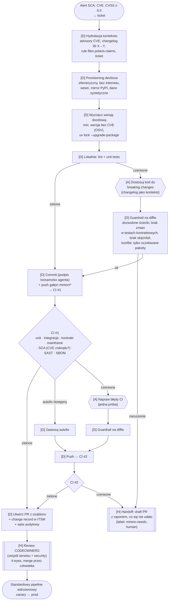

# ASAI-SDLC06, zjazd 2 – praca domowa 02: model Minions w SDLC Polaris

Treść zadania: `pracdom 02.md`
Kontekst firmy i user stories: `../../zjazd-01_2026-11-07/homework/pracdom 01.md`
Poziomy autonomii (L1–L5): `../../zjazd-01_2026-11-07/homework/pracdom-01-odpowiedz.md`

## Zadanie

1. Ustalić, dla których historyjek nadaje się model Minions. Wybór uzasadnić.
2. Zaprojektować blueprint dla miniona realizującego wybraną historyjkę.

## Czym jest model Minions (Stripe, 2026)

Minion to **bezobsługowy agent kodujący, który działa „one-shot”**. Dostaje zadanie (ze Slacka, z ticketu albo z alertu CI) i bez rozmowy z człowiekiem dowozi kompletny PR. Człowiek pojawia się dopiero na review i merge'u, więc w mojej skali autonomii to **L3**.

Kluczowe elementy:

| Element | Co to jest | Po co |
|---|---|---|
| **Blueprint** | Workflow zapisany w kodzie, czyli state machine, w której przeplatają się **węzły deterministyczne** (zwykły kod, bez LLM: lint, push, utworzenie PR) i **węzły agentowe** (pętla LLM: „zaimplementuj zadanie”, „napraw błędy CI”). | To, co musi się wydarzyć zawsze, jest gwarantowane kodem, a nie „prośbą w promptcie”. Mniej tokenów, mniej przebiegów CI, łatwiejszy audyt. |
| **Devbox** | Jednorazowe, izolowane środowisko (u Stripe gotowe w ok. 10 s), odcięte od produkcji i internetu, działające na danych QA. | Blast radius ogranicza się do jednego devboxa, więc agent może działać bez promptów o zgodę. |
| **Toolshed (MCP)** | Centralny serwer MCP (u Stripe prawie 500 narzędzi), z którego minion dostaje **mały, wyselekcjonowany podzbiór**. | Least privilege dla narzędzi i mniej szumu w kontekście. |
| **Rule files** | Reguły przypisane do katalogów i wzorców plików, dołączane, gdy agent wchodzi do danego miejsca w repo. | Kontekst domenowy bez zapychania okna kontekstowego. |
| **Shift-left feedback** | Lokalny lint w kilka sekund, potem pełne CI **najwyżej 2 razy**. Jeśli dalej jest czerwono, zadanie wraca do człowieka. | Ogranicza koszty i nie pozwala agentowi „mielić” w nieskończoność. |
| **Human review** | Każdy PR przegląda człowiek. Agent nie merguje. | Rozliczalność. |

## 1. Które historyjki nadają się na miniona

### Kryteria dopasowania do modelu Minions

Bazuję na kryteriach z pracy domowej 01 i dokładam trzy specyficzne dla modelu one-shot:

1. **Jednoznaczny wyzwalacz i definicja „done”.** Minion nie dopyta, więc zadanie musi być kompletne w ticketcie lub alercie.
2. **Weryfikowalność maszynowa.** Testy, skanery i kontrakty muszą rozstrzygać poprawność, bo pętla „max 2× CI” ma sens tylko wtedy, gdy CI faktycznie coś sprawdza.
3. **Ograniczony zakres zmiany.** Mało plików, jasny obszar repo, da się go wymusić guardrailem na diffie.
4. **Powtarzalność i wolumen.** Blueprint zwraca się dopiero przy wielu uruchomieniach (argument dla CFO).
5. **Odwracalność i skutek błędu.** Bez ruchu pieniędzy, bez danych osobowych w devboxie, revert PR ma wystarczyć.
6. **Wiedza jawna.** Reguły są w kodzie, testach i rule files, a nie w głowie Pana Zdzisława.

### Ocena

| US | Minion? | Uzasadnienie |
|---|---|---|
| US-01 Etykieta w UI | **Tak**, ale niski zwrot | Idealny kształt zadania: 1 plik i18n, regresja wizualna w CI, trywialny revert. Blueprint jest prosty (nawet bez węzła „fix CI”). Pojedyncza zmiana nic jednak nie wnosi biznesowo. Sens ma dopiero jako ogólny blueprint „copy/i18n fix” uruchamiany wprost z ticketu przez analityka lub PO. |
| US-02 Aktualizacja biblioteki (CVE) | **Tak, najlepszy kandydat** | Wyzwalacz maszynowy (alert SCA, CVSS > 9). Definicja „done” jest mierzalna: CVE znika ze skanu, testy są zielone. Zakres ogranicza się do pliku zależności, lockfile i ewentualnych adaptacji API. Zadanie jest powtarzalne (dziesiątki CVE rocznie × 14 zespołów) i odwracalne. Ryzyko złamania interfejsu z mainframe zamyka twarda bramka w postaci testów kontraktowych, których agent nie może ruszyć. Daje też bezpośredni argument dla CISO i DORA: krótszy czas łatania krytycznych podatności. |
| US-04 Schemat bazy (retencja RODO) | **Warunkowo** | Stripe sam używa minionów do migracji (custom blueprint). Minion może przygotować migrację UP/DOWN i przetestować ją na kopii schematu. Problem w tym, że kryterium „brak table locks w godzinach szczytu” trudno w pełni zweryfikować w devboxie bez realnego wolumenu 1,2 mln klientów. Minion przygotowuje więc PR, a decyzję i okno wdrożenia zostawiamy DBA. |
| US-03 Wypłata przez API | **Nie** | To nowa funkcjonalność z ruchem pieniędzy, antyfraudem i wymogami KNF/IDD. Wymaga projektowania i doprecyzowania reguł (limity, uprawnienia), a one-shot agent nie zada pytań. Błąd jest nieodwracalny (przelew poszedł). Wystarczy tu L2. |
| US-05 Raport Solvency II | **Nie** | Artefaktem jest raport dla regulatora, nie zmiana w kodzie. Wymaga formalnej akceptacji aktuariusza i IOD oraz pracy na danych osobowych, a te nie mogą trafić do devboxa. Reguł aktuarialnych nie zweryfikuje CI. |
| US-06 Refaktoryzacja `LIKWSZK` | **Nie** (dziś) | Wiedza jest ukryta, brak testów regresji i COBOL na mainframe, gdzie nie ma taniego, izolowanego devboxa. **Później** minion może dostać wąskie, powtarzalne podzadania, np. generowanie testów charakteryzacyjnych z golden datasetu 10 000 szkód, gdy ten zbiór już powstanie. |

**Wybór: US-02.** To jedyna historyjka, która jednocześnie ma maszynowy wyzwalacz, maszynową definicję „done”, wysoki wolumen i mierzalny zwrot (MTTR podatności). Przy okazji odpowiada na obawy CISO, bo agent dostaje osobną tożsamość, a ślad zmian spełnia wymóg DORA „kto co zmienił”.

## 2. Blueprint: `dep-cve-bump` dla `polaris-claims`

### Założenia

- **Wyzwalacz:** alert SCA (np. Dependabot / Snyk / pip-audit w nightly) z CVSS ≥ 9.0, który automatycznie tworzy ticket i z niego startuje minion. Można też uruchomić go ręcznie z ticketu (przycisk „Napraw minionem”).
- **Wyjście:** PR do `polaris-claims` z kompletnym materiałem dowodowym, gotowy do review przez CODEOWNERS. **Agent nie merguje i nie wdraża.**
- **Budżet:** max 1 iteracja agenta na adaptację kodu i max 2 przebiegi CI. Po przekroczeniu następuje handoff do człowieka.

### Diagram

Legenda: `[D]` węzeł deterministyczny (kod), `{{A}}` węzeł agentowy (LLM), `[[H]]` człowiek.

### Węzły w szczegółach

| # | Typ | Węzeł | Co robi | Dlaczego tak |
|---|---|---|---|---|
| D1 | D | Hydratacja kontekstu | Pobiera advisory CVE z SCA, changelog biblioteki między wersjami (z mirrora), ticket i rule files dla `polaris-claims` (np. `rules/integration-mainframe.md`: „nie zmieniaj formatu pól z copybooka `LIKWSZK`”). | Kontekst ma być kompletny, zanim ruszy LLM. Agent nie szuka po internecie. |
| D2 | D | Devbox | Efemeryczny kontener lub VM z obrazem CI `polaris-claims`. **Brak internetu**, jedyne wyjście to wewnętrzny mirror PyPI. **Dane syntetyczne**, zero danych klientów. Po zakończeniu runu devbox jest niszczony. | RODO (zdjęcia szkód, dane medyczne nie trafiają do agenta). Ochrona przed supply chain (prompt injection z README paczki nie wyśle niczego na zewnątrz). |
| D3 | D | Bump wersji | Wybiera **minimalną** wersję naprawiającą CVE (OSV / pip-audit) i aktualizuje `pyproject.toml` oraz lockfile. | Sam bump jest deterministyczny i **nie potrzebuje LLM**. Agent wchodzi dopiero, gdy coś się zepsuje. |
| D4 | D | Szybki feedback | Lint i testy jednostkowe lokalnie, w kilka–kilkadziesiąt sekund. | Shift-left: w większości przypadków bump przechodzi i agent nie zużywa ani jednego tokena. |
| A1 | A | Adaptacja kodu | Pętla LLM z changelogiem i błędami testów. Może edytować tylko `src/**` i testy jednostkowe, które bezpośrednio dotyczą zmienionego API. | Jedyne miejsce, gdzie potrzebna jest „inteligencja”: breaking changes w API biblioteki. |
| D5 | D | Guardrail na diffie | Odrzuca zmiany w `tests/contract/**`, `.github/workflows/**`, `CODEOWNERS`, konfiguracji skanerów. Odrzuca dodanie `skip`, `xfail` czy `# nosec` oraz nowe zależności spoza listy tranzytywnych. | Agent **nie może osłabić** bramki, która go ocenia. Kontrakt z mainframe jest nienaruszalny. |
| C1/C2 | D | CI | Testy unit, integracyjne, **kontraktowe interfejsu mainframe** (na stubie lub emulatorze z copybooków), ponowny skan SCA (czy CVE faktycznie zniknęło), SAST, generowanie SBOM. | To realizuje AC z US-02. Kompatybilność wsteczną z mainframe weryfikują kontrakty, a nie deklaracja agenta. |
| A2 | A | Fix CI | Jedna próba naprawy na podstawie logów CI. | Limit 2× CI: koszt pod kontrolą, brak nieskończonej pętli. |
| D7 | D | PR + audyt | PR z szablonu: CVE, CVSS, wersja X→Y, podsumowanie changelogu, lista zmian w kodzie, wyniki testów, diff SBOM, **run ID, wersja modelu, hash promptu i blueprintu, kto zainicjował**. Automatycznie powstaje change record w ITSM. | DORA (zarządzanie zmianą ICT, rozliczalność). Reviewer dostaje dowody, a nie tylko diff. |
| H1 | H | Review i merge | CODEOWNERS: zespół serwisu + security champion. Branch protection: merge wyłącznie przez człowieka, wymagane 2 approvals. | Odpowiedzialność za zmianę na produkcji ponosi człowiek. |
| H2 | H | Handoff | Draft PR z opisem, co nie przeszło i co agent próbował zrobić. | Porażka miniona nie jest stratą: człowiek startuje z gotowym kontekstem. |

### Narzędzia (podzbiór „Toolshed”)

| Dozwolone | Zabronione |
|---|---|
| `repo.read`, `repo.edit` (w dozwolonych ścieżkach), `tests.run`, `lint.run`, `sca.get_advisory`, `pkg.get_changelog` (z mirrora), `ci.get_logs` | merge, deploy, dostęp do sieci zewnętrznej, sekrety i vault, produkcyjne bazy danych, zmiana ustawień repo i branch protection, narzędzia innych zespołów |

### Tożsamość i bezpieczeństwo (odpowiedź na uwagę CISO)

- **Osobna tożsamość nieludzka per blueprint:** `svc-minion-dep-cve-bump`, workload identity z krótkożyjącymi tokenami (OIDC), bez stałych haseł i kluczy.
- **Uprawnienia w Git:** push tylko na gałęzie `minion/*`, otwieranie PR, brak merge'u. Branch protection na `main` blokuje tę tożsamość.
- **Podpisane commity** tożsamością agenta (np. gitsign/Sigstore) z trailerem `Requested-by: <inicjator>` i `Minion-Run: <id>`. Pozwala to odpowiedzieć na pytanie „kto co zmienił”: agent X na zlecenie Y, zatwierdził Z.
- **Logi runu** (prompty, wywołania narzędzi, diffy) trafiają do SIEM. Reguły ITDR alarmują przy anomaliach (próba wyjścia poza mirror, dostęp do ścieżek spoza allowlisty, nietypowa liczba runów).
- **Kill switch:** wyłączenie blueprintu jednym przełącznikiem i odwołanie tożsamości bez wpływu na ludzi i inne blueprinty.
- **Shadow AI:** minion to oficjalna, audytowalna ścieżka dla zadań, które dziś programiści wrzucają do prywatnego ChatGPT.

### Metryki (odpowiedź na uwagę CFO)

| Metryka | Po co |
|---|---|
| **MTTR krytycznego CVE** (od alertu do merge'u), przed i po | Główny wskaźnik zwrotu i ryzyka DORA. |
| % runów zakończonych zielonym PR bez udziału człowieka | Skuteczność blueprintu. |
| % PR-ów zmergowanych bez poprawek reviewera | Jakość. |
| Czas reviewera na PR | Czy minion faktycznie odciąża zespół, a nie przerzuca pracę na review. |
| Koszt runu (tokeny + CI) vs. koszt godzinowy inżyniera | Twardy ROI. |

## Pytania otwarte

- Czy mamy testy kontraktowe interfejsu `polaris-claims` ↔ mainframe? Jeśli nie, to jest **warunek wstępny** dla US-02, a ich zbudowanie przy okazji pomaga w US-06 (wiedza Pana Zdzisława).
- Czy dla US-01 dopuścić auto-merge (L4) po zielonym CI z regresją wizualną, czy trzymać jedną regułę „człowiek zawsze merguje” dla wszystkich minionów, bo tak jest prościej audytowo?
- Kto jest właścicielem blueprintów (platform team vs. zespoły produktowe) i kto zatwierdza zmiany w samym blueprincie? Blueprint to kod z uprawnieniami, więc powinien mieć własny proces review.

## Źródła

- [Minions: Stripe's one-shot, end-to-end coding agents](https://stripe.dev/blog/minions-stripes-one-shot-end-to-end-coding-agents)
- [Minions – Part 2 (blueprints, Toolshed, feedback loop)](https://stripe.dev/blog/minions-stripes-one-shot-end-to-end-coding-agents-part-2)
